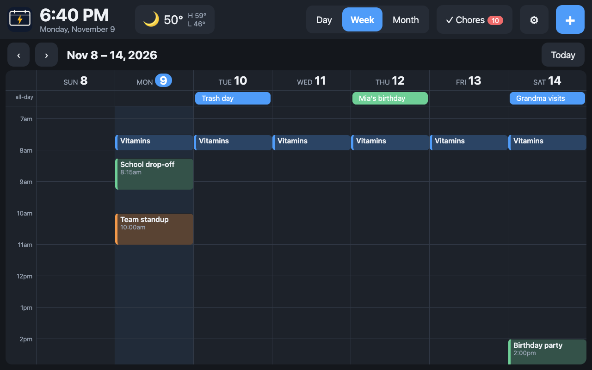
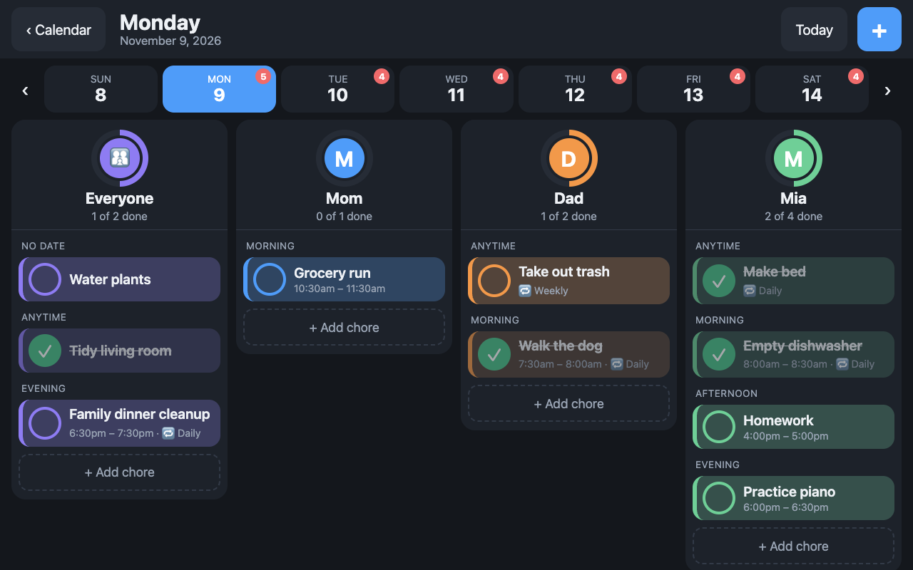
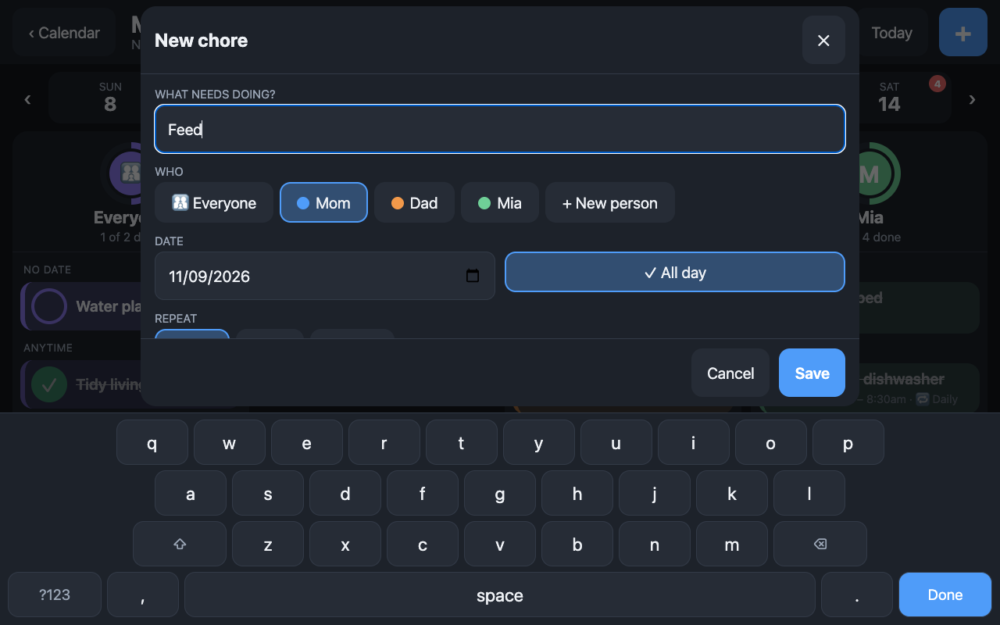

<h1 align="center"></h1>

<p align="center">A self-hosted family wall calendar for a Raspberry Pi touchscreen. It syncs two-way with Google Calendar, shows the weather, and runs a Skylight-style chore board, all without any third-party app or cloud service seeing your data.</p>



## Contents
- [Features](#features)
- [Screenshots](#screenshots)
- [How it works](#how-it-works)
- [Quick start](#quick-start)
- [Configuration](#configuration)
- [Google Calendar](#google-calendar)
- [Deploy on a Raspberry Pi](#deploy-on-a-raspberry-pi)
- [Updating a deployed Pi](#updating-a-deployed-pi)
- [Security and privacy](#security-and-privacy)
- [API](#api)
- [Development](#development)
- [Roadmap](#roadmap)
- [License](#license)

## Features
- **Calendar.** Day, week and month views. Add, edit and delete events by tapping. Repeating events (daily, weekly, monthly, yearly) and all-day events and birthdays are supported.
- **Two-way Google Calendar sync.** Uses your own Google Cloud project with incremental sync. Edits on the wall reach Google within seconds, and changes made on a phone show up within two minutes.
- **Chores.** A full-screen board with a column per person and a shared "Everyone" column, a progress ring per person, and a week strip to pick the day. Chores can be timed or all-day, can repeat daily or weekly, and are ticked off per day.
- **Family members.** Each person gets a color that carries through the calendar and the chore board.
- **Weather.** Current conditions, hourly and 7-day forecast from [Open-Meteo](https://open-meteo.com/). No account or API key.
- **Built-in on-screen keyboard.** Designed for the wall touchscreen, so you can type without attaching a keyboard. Phones use their own keyboard.
- **Touch scrolling.** Drag any scrollable area with a finger and it follows and coasts. Chromium's own touch panning does not work in the Pi's Wayland kiosk, so the page handles it itself (`ui/js/touchscroll.js`).
- **Kiosk mode.** A systemd service and a full-screen Chromium kiosk that starts at boot and restarts nightly to keep memory low.
- **Lean.** Plain HTML, CSS and JavaScript with no framework and no build step. Python backend with SQLite and four dependencies.

## Screenshots
| Chores | On-screen keyboard |
| --- | --- |
|  |  |

## How it works
```
 Google Calendar  <--sync-->  Backend (FastAPI + SQLite)  <--HTTP API-->  UI (HTML/CSS/JS)
                                      ^                                      |
                                      |                         Chromium kiosk on the Pi,
                               Open-Meteo (weather)             or a phone browser
```
- **Backend** runs as a background service, talks to Google and Open-Meteo, stores data in SQLite and serves a local HTTP API. It never draws the screen.
- **UI** is a static web page served by the backend. It only talks to the backend API, so either side can move to another device later.
- **Chores and members** live in SQLite on the device. They are not synced to Google.

```
backend/skybolt/   FastAPI app: events, chores, members, weather, Google sync
backend/tests/     pytest suite
ui/                index.html, style.css and ES modules under js/
deploy/            install.sh, update.sh, kiosk script and systemd units
```

## Quick start
Requires [uv](https://docs.astral.sh/uv/) (Python 3.11 or newer is installed for you).
```sh
./run.sh            # starts http://127.0.0.1:8000 (installs dependencies on first run)
./run.sh seed       # in another terminal: load demo data (once)
uv run pytest       # run the tests
```
Interactive API docs are at http://127.0.0.1:8000/docs. Screens can be opened directly: `/?view=month`, `/?open=weather`, `/?open=chores`, `/?open=settings`, `/?open=add`.

## Configuration
Settings come from environment variables or a `.env` file in the project root. Copy [.env.example](.env.example) to `.env` and change what you need. Everything is optional.

| Variable | Default | Purpose |
| --- | --- | --- |
| `SKYBOLT_HOST` | `127.0.0.1` | Address to listen on. See [Security and privacy](#security-and-privacy) before changing. |
| `SKYBOLT_PORT` | `8000` | Port to listen on. |
| `SKYBOLT_DB_PATH` | `data/skybolt.db` | SQLite database location. |
| `SKYBOLT_LAT`, `SKYBOLT_LON` | New York | Coordinates for the weather. |
| `SKYBOLT_LOCATION_NAME` | `Home` | Label shown with the weather. |
| `SKYBOLT_UNITS` | `imperial` | `imperial` or `metric`. Can also be switched in the weather panel. |
| `SKYBOLT_TIMEZONE` | system | IANA time zone, used for repeating Google events. |
| `SKYBOLT_GOOGLE_SYNC_SECONDS` | `120` | Seconds between background Google syncs; `0` disables it. |
| `SKYBOLT_SECRET_KEY` | generated | Key that encrypts the stored Google sign-in. Generated into `data/secret.key` if empty. |
| `SKYBOLT_GOOGLE_CREDENTIALS` | `credentials.json` | Optional OAuth client file, as an alternative to pasting it in Settings. |

## Google Calendar
Skybolt uses your own Google Cloud project, so no other service sees your data.

1. Open Skybolt on the Pi at http://localhost:8000 and go to **Settings > Google Calendar**.
2. Follow the five steps shown there. Each has a direct link. You create a free Google Cloud project, enable the Calendar API, publish the app and create a **Desktop app** client.
3. Paste the Client ID and secret into the boxes and sign in.

Publish the app ("In production", not "Testing") in step 4, otherwise Google signs you out every seven days. Sign-in details are stored encrypted in `data/`.

## Deploy on a Raspberry Pi
**Developed on:** a Raspberry Pi 5 (4 GB) running Raspberry Pi OS (Debian 13 "Trixie") with the desktop (labwc), Chromium and [uv](https://docs.astral.sh/uv/), driving a 10.1" touchscreen. The UI is sized for 1024x600 and scales to 1280x800.

```sh
git clone https://github.com/vishy2k5/skybolt.git
cd skybolt
deploy/install.sh backend     # systemd service on 127.0.0.1:8000, starts at boot
deploy/install.sh kiosk-on    # full-screen browser now and at every desktop login
deploy/install.sh kiosk-off   # back to the normal desktop
deploy/install.sh uninstall   # remove the services (keeps data/)
```
- **Auto-login.** For a wall display, enable desktop auto-login: `sudo raspi-config nonint do_boot_behaviour B4`.
- **Nightly restart.** The kiosk browser restarts at 04:00 to keep memory use low.
- **Touch scrolling.** Built in, and active only on the Pi's own screen (page loaded from `127.0.0.1`); phones keep their native scrolling. Add `?ts=0` to the URL to turn it off.
- **Leaving the kiosk.** The kiosk takes over the screen. Closing the browser only reloads it, so run `deploy/install.sh kiosk-off` to get the desktop back.
- **On-screen keyboard.** Built in (`ui/js/keyboard.js`); no system keyboard is needed. It appears on the Pi's own screen only, not on phones. Add `?kb=1` or `?kb=0` to the URL to force it on or off.
- **Logs.** `journalctl -u skybolt -f`.
- **After changing `.env`:** `sudo systemctl restart skybolt`.

## Updating a deployed Pi
From another computer on the same network or [Tailscale](https://tailscale.com/), run the update script on the Pi over SSH:
```sh
ssh -t <user>@<pi> '<path to skybolt>/deploy/update.sh'
```
It pulls the latest code from GitHub, syncs dependencies, restarts the backend and reloads the kiosk. The `-t` is needed because the restart uses `sudo`. The script stops if the Pi has local commits that diverge from GitHub; fix that on the Pi first (`git pull --rebase`).

Chores and members are stored in SQLite and migrated automatically on start-up when the schema changes.

## Security and privacy
- **No third-party services.** All data stays on your devices. There are no analytics, ads or tracking. The only outbound requests are to Google (Calendar API) and Open-Meteo (weather, which receives your configured coordinates). See [PRIVACY.md](PRIVACY.md).
- **The API has no authentication yet.** Anyone who can reach the port can read and edit the calendar and change the Google connection. The default `SKYBOLT_HOST=127.0.0.1` keeps it reachable only from the device itself. Do not expose it to your network or the internet until login is added. For remote administration, use SSH over Tailscale rather than opening a port.
- **Google sign-in.** Stored encrypted in `data/` using a key kept on the same device (`data/secret.key` with `0600` permissions, or `SKYBOLT_SECRET_KEY`). This protects the token from casual copying, but anyone with full access to the Pi's files can still decrypt it. Disconnecting in Settings, or removing the app at https://myaccount.google.com/permissions, revokes access.
- **Secrets.** `.env`, `credentials.json`, `token.json`, `data/` and `*.db` are git-ignored. GitHub secret scanning and push protection are enabled on the repository.

## API
The UI uses this API, and so can your own scripts. Full interactive docs are at `/docs` on a running server.

| Area | Endpoints |
| --- | --- |
| Health | `GET /api/health` |
| Events | `GET /api/events?start=&end=`, `POST /api/events`, `GET`, `PUT`, `DELETE /api/events/{id}` |
| Chores | `GET /api/chores?start=&end=` (occurrences, repeats expanded), `GET /api/chores/open` (overdue and undated), `POST /api/chores`, `PUT`, `DELETE /api/chores/{id}`, `PATCH /api/chores/{id}` (mark a day done or not) |
| Members | `GET`, `POST /api/members`, `PUT`, `DELETE /api/members/{id}` |
| Weather | `GET /api/weather?units=` |
| Google | `GET /api/google/status`, `POST /api/google/client`, `GET /api/google/connect`, `POST /api/google/sync`, `PUT /api/google/calendars/{id}`, `POST /api/google/disconnect` |

A chore with no person belongs to everyone. A chore with no start time is all-day. Repeating chores keep one completion record per day.

## Development
```sh
uv run pytest                 # backend tests
./run.sh seed                 # demo data for the UI
```
- The backend uses FastAPI and SQLite with only four runtime dependencies. The UI is plain ES modules with no build step, so edit a file in `ui/` and reload the page.
- The UI is served with `Cache-Control: no-cache`, so a deploy shows up on the next page load.
- Keep it lean: no video, no heavy animations and no large JavaScript bundles. The target budget is about 150 MB for the OS, 300-500 MB for the browser and 100-150 MB for the backend.

## Roadmap
Done: Google Calendar sync, calendar views, chores, weather, on-screen keyboard, Raspberry Pi kiosk deployment.

Planned:
- Login for the phone-friendly add and edit page, then listening on the Tailscale address only.
- Google Tasks.
- Meal planner, recipes and grocery list.
- Photo slideshow and screensaver.
- A read-only MCP server so an AI assistant can read calendars, tasks and meals, with write tools added later.

## License
Source-available under the [PolyForm Noncommercial License 1.0.0](LICENSE). Free to use, modify and share for personal, hobby, research and other noncommercial purposes. Commercial use is not permitted.
